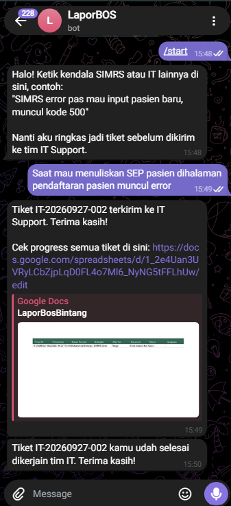
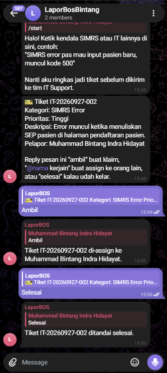

# IT Support Telegram Bot

Bot Telegram untuk laporan kendala IT/SIMRS dari pengguna (mis. staf rumah sakit yang pakai
Sistem Informasi Manajemen Rumah Sakit sehari-hari). User ketik keluhan bebas ("SIMRS error
pas input pasien baru"), LLM (lewat Groq, gratis) mengekstrak kategori/prioritas/deskripsi jadi
tiket terstruktur, lalu, setelah dikonfirmasi pelapor, dicatat sebagai baris baru di Google
Sheet dan diteruskan ke grup Telegram tim IT Support. Tim IT tinggal **reply** pesan tiket itu:
"ambil" untuk klaim sendiri, "@nama kerjain" untuk assign ke rekan lain, atau "selesai" untuk
menutup tiket. Bot otomatis update kolom Status & Assignee di Sheet, dan mengirim notifikasi
balik ke pelapor lewat DM begitu tiketnya selesai dikerjakan.

## Demo

| Pelapor (DM) | Tim IT Support (Grup) |
|---|---|
|  |  |

## Arsitektur

```
Pengguna SIMRS (DM) -> bot.py -> llm.py (LLM via Groq: ekstraksi terstruktur)
                               -> konfirmasi (tombol Kirim/Batal)
                               -> sheets.py (append row, status Open)
                               -> post ringkasan tiket ke grup IT Support

Grup IT Support -> reply "ambil" / "@nama kerjain" / "selesai" -> assign.py (parse aksi & siapa yang di-assign)
                                                                -> sheets.py (update Status + Assignee)
                                                                -> notifikasi DM ke pelapor kalau selesai
```

- **Prompt engineering**: `llm.py` memaksa model balas JSON saja, lalu `parse_extraction`
  memvalidasi kategori/prioritas dan fallback ke default aman kalau modelnya nggak patuh format.
- **Data pipeline**: setiap tiket yang dikonfirmasi masuk ke Google Sheet dengan ticket ID
  otomatis (`IT-YYYYMMDD-NNN`), timestamp, status, dan assignee.
- **Assignment flow**: bot memetakan `message_id` pesan tiket di grup ke `ticket_id` (in-memory),
  jadi reply ke pesan itu tahu tiket mana yang dimaksud. `assign.py` cuma regex `@nama`, replier
  sendiri jadi default kalau nggak ada mention, jadi nggak perlu LLM buat hal sesederhana ini.

## Setup

1. **Bot Telegram**: chat `@BotFather` di Telegram, `/newbot`, salin token ke `.env` sebagai
   `TELEGRAM_BOT_TOKEN`.
2. **Groq API key** (gratis): daftar di console.groq.com, buat API key, isi `GROQ_API_KEY`.
3. **Google Sheet**:
   - Buat Google Sheet baru, baris pertama diisi header:
     `Ticket ID | Timestamp | Nama Pelapor | Kategori | Prioritas | Deskripsi | Status | Assignee`
   - Buat service account di Google Cloud Console, aktifkan Google Sheets API, download
     JSON key-nya, simpan sebagai `service_account.json` di folder ini.
   - Share sheet-nya (klik Share) ke email service account (ada di file JSON-nya) dengan akses Editor.
   - Isi `GOOGLE_SHEET_ID` di `.env` dengan ID dari URL sheet (bagian antara `/d/` dan `/edit`).
4. **Grup Telegram tim IT Support**: buat grup, invite bot jadi member, kirim `/start` di grup lalu
   ambil `chat_id`-nya dari `https://api.telegram.org/bot<TOKEN>/getUpdates`, isi ke `.env` sebagai
   `IT_GROUP_CHAT_ID`.
5. Copy `.env.example` jadi `.env`, isi semua nilainya.
6. Install dependency dan jalankan:
   ```
   pip install -r requirements.txt
   python bot.py
   ```
